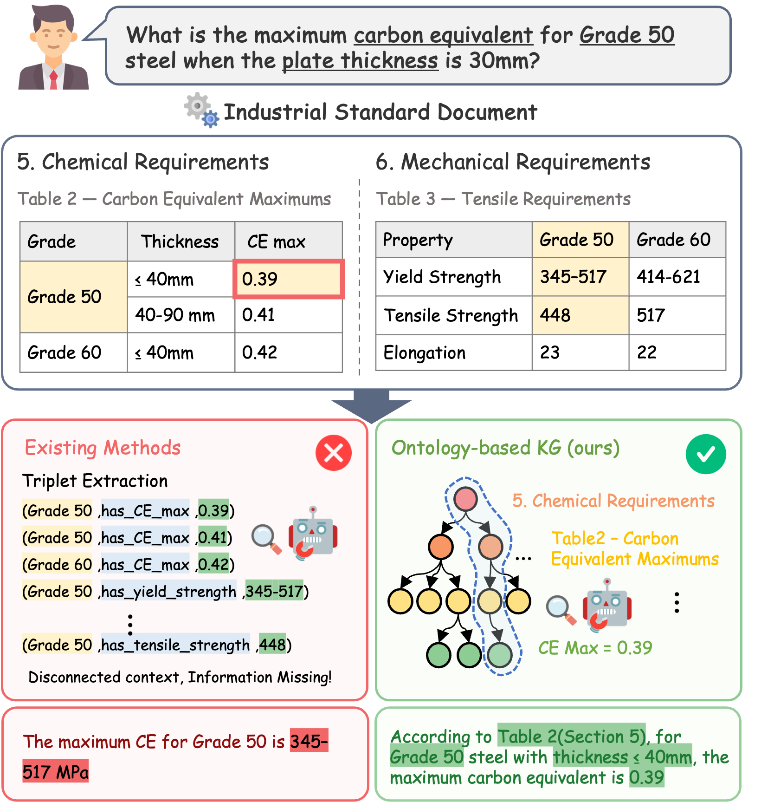
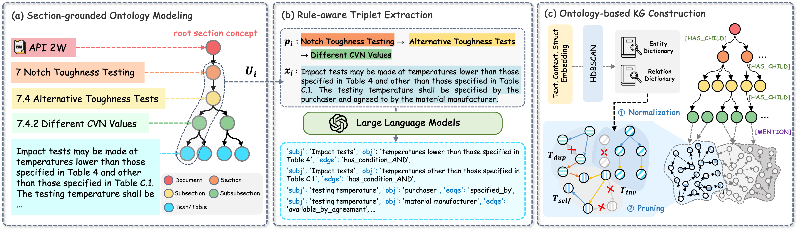

<div align="center">
  <h1>Ontology-Based Knowledge Graphs for Industrial Standards with Scope-Aware Logical Rule Structuring</h1>

  <a href="https://2026.emnlp.org/">
    
  </a>
  
  

<p>
<a href="https://idsl.hanyang.ac.kr/members/students/%EB%B0%95%EC%A7%80%EC%9D%B8"><strong>Jiin Park†</strong></a>,
<a href="https://idsl.hanyang.ac.kr/members/students/%EC%A0%84%ED%98%84%EC%95%84"><strong>Hyuna Jeon†</strong></a>,
<strong>Yoonseo Lee</strong>,
<strong>Misuk Kim*</strong>
</p>

<p>
  <sub>† Equal contribution &nbsp;&nbsp; * Corresponding author</sub>
</p>

  <p>
    📄 <a href="https://aclanthology.org/2026.emnlp-main.1456/"><strong>Paper</strong></a>
  &nbsp; | &nbsp;
  <a href="https://aclanthology.org/2026.emnlp-main.1456.pdf"><strong>PDF</strong></a>
  &nbsp; | &nbsp;
  <a href="https://github.com/Ontology-KG/ontology_based_kg_paper"><strong>Code</strong></a>
    &nbsp;|&nbsp;
    <a href="https://huggingface.co/datasets/zzin/IndusSpec-QA">🤗 Dataset</a>
  </p>
</div>

---

This is the official repository for **Ontology-Based Knowledge Graphs for Industrial Standards with Scope-Aware Logical Rule Structuring**, accepted to the **Main Conference of EMNLP 2026**.

We introduce an ontology-based knowledge graph framework for question answering over industrial standards. The framework explicitly preserves document hierarchy and section scope while structuring textual and tabular rules, compound conditions, and their relations for more reliable retrieval and reasoning.

<p align="center">
  
</p>

Conventional triplet-based knowledge graphs can lose the hierarchical and contextual information required to correctly interpret rules in industrial standards. Our ontology-based KG preserves document structure and section context, allowing retrieved facts and rules to remain grounded in their original scope.

---

## Method Overview

Our framework consists of three main stages:

1. **Section-grounded Ontology Modeling** — models the hierarchical structure of industrial standards and preserves section-level scope.
2. **Rule-aware Triplet Extraction** — extracts structured relations from textual and tabular requirements while retaining compound logical conditions.
3. **Ontology-based KG Construction** — integrates document structure and extracted rules into a unified knowledge graph for downstream question answering.

<p align="center">
  
</p>

---

## 📂 Dataset

We introduce **IndusSpec-QA**, a question-answering benchmark constructed from industrial standards.

The dataset includes three major question types:

- **Rule**: Questions requiring interpretation of explicit requirements, constraints, or conditions.
- **Multi-hop**: Questions requiring information across multiple sections or relations.
- **Table**: Questions requiring structured information contained in tables.

The dataset used in this paper is publicly available on Hugging Face:

👉 [**Download IndusSpec-QA**](https://huggingface.co/datasets/zzin/IndusSpec-QA)

---

## Citation

If you use this work, please cite:

```bibtex
@inproceedings{park-etal-2026-ontology,
    title = "Ontology-Based Knowledge Graphs for Industrial Standards with Scope-Aware Logical Rule Structuring",
    author = "Park, Jiin  and
      Jeon, Hyuna  and
      Lee, Yoonseo  and
      Kim, Misuk",
    editor = "Lee, Hung-Yi  and
      Dev, Sunipa  and
      Li, Jessy  and
      Elliott, Desmond",
    booktitle = "Proceedings of the 2026 Conference on Empirical Methods in Natural Language Processing",
    month = oct,
    year = "2026",
    address = "Budapest, Hungary",
    publisher = "Association for Computational Linguistics",
    url = "https://aclanthology.org/2026.emnlp-main.1456/",
    doi = "10.18653/2026.emnlp-main.1456",
    pages = "33282--33311",
    ISBN = "979-8-89176-459-0"
}
```


